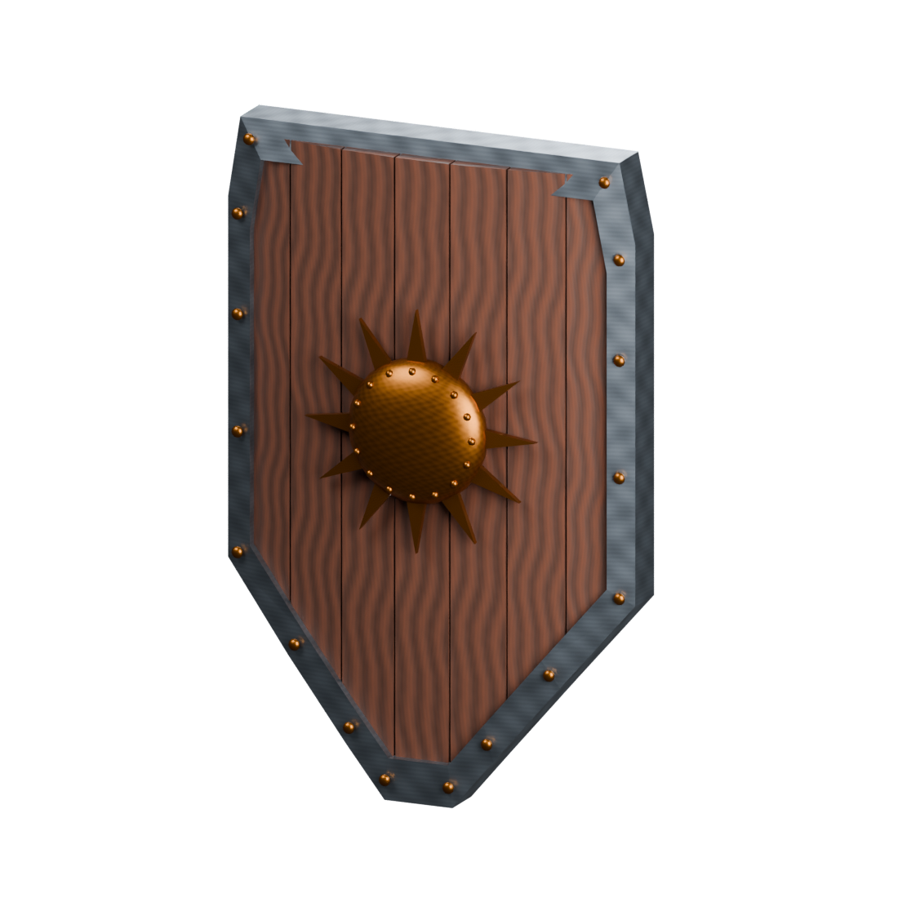

# AR SOLIS · Escudo Solar

Escudo medieval original para tiempo real, modelado en Blender 5.2 y mostrado mediante **Google model-viewer 4.4.0**. Combina madera, acero y bronce; incluye parte trasera, travesaños y empuñadura.

**Página pública:** https://roapapu.github.io/Escudo_Blender/



## Entrega y requisitos

| Requisito | Implementación |
| --- | --- |
| Modelo ligero | 4,272 triángulos. El GLB agrupa las piezas en tres mallas por material. |
| Tres materiales | Madera en tablones y agarre; acero en borde y travesaños; bronce en emblema, remaches y soportes. |
| UV | Todas las piezas tienen UV, normales y tangentes. Despliegue Smart UV con separación de islas de 0.025. Las piezas reutilizan el espacio de textura por material. |
| PBR | Base Color, Roughness, Metallic y Normal de 1024 × 1024 para cada material y acabado. |
| Optimización | Roughness y Metallic combinados en ORM (R=1, G=roughness, B=metallic); texturas embebidas en el GLB. Sin dependencias de servicios de modelos externos. |
| Interactividad | Tres botones modifican materiales sin reemplazar la geometría. |
| Publicación | GitHub Pages mediante el workflow incluido. |

## Archivos

- `source/Escudo_Solar.blend`: fuente editable con piezas separadas, materiales, texturas empaquetadas, cámara y luces.
- `assets/escudo.glb`: modelo listo para web, con materiales y mapas integrados.
- `textures/`: mapas independientes de los tres materiales, en dos acabados.
- `renders/`: vistas del frente y reverso.
- `index.html`, `style.css`, `app.js`: página adaptable y controles accesibles.
- `vendor/`: model-viewer con su licencia Apache 2.0, servido localmente por la página.
- `scripts/build_shield.py`: generación reproducible del modelo y los mapas en Blender.
- `validation-gltf.json`, `validation-summary.json`: resultados del validador Khronos y comprobaciones de entrega.
- `VALIDACION.md`: revisión visual y funcional.

## Los tres botones

1. **Acero oscuro:** multiplica el Base Color del acero entre blanco y azul gris oscuro.
2. **Huella del tiempo:** cambia Base Color, ORM y Normal de los tres materiales entre limpio y gastado. Descarga los mapas antes de aplicarlos, conserva la apariencia en caso de fallo y reutiliza las texturas ya cargadas.
3. **Relieve del bronce:** desactiva/restaura el normal map del bronce respetando el acabado elegido.

Los controles conservan su estado al combinarse. También se puede girar y acercar el escudo con los controles de cámara del visor.

## Flujo de materiales y bake

Los mapas son originales, generados dentro de Blender con funciones procedurales muestreadas en imágenes de 1K. El relieve se convierte desde un campo de altura a normales de espacio tangente (+Y, compatible con glTF). Se trata de un horneado de superficie procedural; **no se utilizó Substance Painter ni un bake de una malla de alta resolución**. Los rayones, vetas y variaciones superficiales residen en las texturas. Base Color usa sRGB; los mapas de datos usan Non-Color. El GLB utiliza el flujo metallic-roughness.

Para inspeccionar en Blender: abre el `.blend`, selecciona una pieza y entra en **UV Editing** para ver su UV, o en **Shading** para revisar los cuatro mapas conectados al Principled BSDF mediante un nodo Normal Map para las normales.

## Ejecutar localmente

Se requiere Node.js. Las dependencias ya están fijadas en `package-lock.json`.

```sh
npm ci
npm run serve
```

Abre `http://127.0.0.1:4173`. No abras el HTML mediante `file://`, ya que el navegador necesita HTTP para cargar el modelo y las texturas.

```sh
npm run validate
```

Para reconstruir el modelo desde la raíz del proyecto:

```sh
blender --background --python scripts/build_shield.py
```

El script vuelve a generar `.blend`, GLB, mapas y renders. Conserva una copia si editaste manualmente estos archivos. Si cambias la versión de model-viewer, copia `node_modules/@google/model-viewer/dist/model-viewer.min.js` y su licencia a `vendor/`.

## Publicación

El workflow `.github/workflows/pages.yml` publica solamente HTML, CSS, JS, modelo, mapas, renders y biblioteca. Los fuentes `.blend`, scripts y reportes permanecen en el repositorio para revisión. GitHub Pages debe usar **GitHub Actions** como origen; cada push a `main` ejecuta el despliegue.

## Documentación consultada

- [model-viewer: documentación](https://modelviewer.dev/)
- [API de materiales y ejemplos](https://modelviewer.dev/examples/scenegraph/)
- [Validador oficial Khronos glTF](https://github.com/KhronosGroup/glTF-Validator)

No se usaron modelos ni texturas de terceros. El diseño es una pieza artística de temática medieval, no una reconstrucción histórica.
